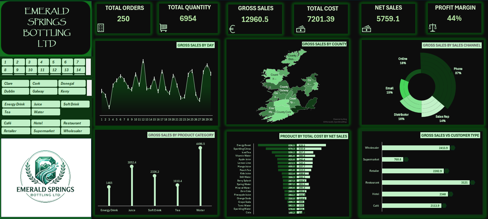

# Sales and Order Analysis

Monthly sales and order analysis for an Irish beverage distributor, built in Excel. This project cleans and connects raw operational data, calculates commercial metrics, and turns them into a dashboard and findings that support management decisions.

> Portfolio case study using a supplied sales and order dataset. Covers June 2026.

---

## Project Overview

The business produces and distributes bottled water, juices, soft drinks, teas and energy drinks. It sells to restaurants, hotels, retailers, wholesalers, supermarkets and cafés across Ireland. Customers order through five channels: phone, online, sales reps, distributors and email.

Each month the business records its orders, products and customers, but the raw data arrives uncleaned and split across separate tables. This project takes one month of that activity and turns it into a single connected dataset, a set of commercial metrics, and a dashboard management can act on.

---

## Business Problem

Management could see revenue was healthy but could not see what was driving it. The raw data had five issues:

- Customer, product and order records sat in three separate tables with no link between them
- The order table held 259 rows for 250 real orders, carrying 5 duplicated records and 4 completely blank rows
- `Order_Status` appeared in 15 different spellings, including spaces inside words, plus 4 blanks
- Two `Order_ID` values carried a space inside the ID, breaking any lookup built on them
- Order dates were stored as serial numbers, not readable dates

Without cleaning and connecting the data, the business could not reliably answer basic questions like which products sell, which customers buy most, or which regions drive revenue.

---

## Project Objectives

- Reconcile the order table to one row per real order
- Standardise inconsistent text fields and convert serial-number dates to standard dates
- Connect the customers, products and orders tables using ID-based lookups
- Calculate order, sales, cost, discount and profit metrics
- Summarise findings in a dashboard and translate them into business recommendations

---

## Business Questions

1. What do the core metrics reveal about overall business health?
2. What is the daily revenue trend, and which day peaked?
3. Which county drives the highest revenue?
4. Which customer channel preference carries the most revenue?
5. Which product category contributes the most to revenue?
6. What is the cost and profit per product?
7. How does revenue break down by customer type?

---

## Dataset and Data Description

Three source tables covering June 2026:

| Table | Raw records | After cleaning | Key fields |
|---|---|---|---|
| Customers | 100 | 100 | Customer_ID, County, Customer_Type, Preferred_Channel |
| Products | 20 | 20 | Product_ID, Category, Bottle_Size, Unit_Price, Cost_Price |
| Orders | 259 | 250 | Order_ID, Order_Date, Customer_ID, Product_ID, Quantity, Discount, Order_Status |

The three tables connect through `Customer_ID` and `Product_ID`.

---

## Tools and Technologies

- Microsoft Excel for data cleaning, analysis and dashboard
- Functions: `TRIM`, `CLEAN`, `PROPER`, `SUBSTITUTE`, date conversion, `VLOOKUP`, `INDEX`/`MATCH`, `SUMIFS`, `COUNTIFS`
- PivotTables and dashboard visuals with slicers

---

## Data Cleaning and Preparation

- Reconciled 259 raw rows down to 250 unique orders by removing 5 duplicated records and 4 blank rows
- Corrected two `Order_ID` values stored with a space inside the ID, which would have broken every lookup built on them
- Standardised `Order_Status` from 15 spellings down to three valid values. The field contained leading spaces, trailing spaces, spaces inside words such as `Com  pleted` and `Pen ding`, and 4 blank entries
- Standardised remaining text fields with `TRIM`, `CLEAN` and `PROPER`
- Converted order dates from serial-number format to standard short dates
- Connected the three tables with ID-based lookups, so every order line carries the customer's county, type and channel preference, plus the product's category, bottle size, unit price and cost price
- Built calculated fields at line level: gross sales, total cost, discount and profit
- Cross-checked every summary figure against a control total before accepting it

---

## KPIs and Calculations

| Metric | Definition |
|---|---|
| Gross Sales | Unit price × quantity |
| Total Cost | Cost price × quantity |
| Total Discount | Value given through discounting |
| Profit | Gross sales − cost − discount |
| Profit Margin | Profit as a percentage of gross sales |

All metrics are calculated across the full order book of 250 orders, including the 6 cancelled orders, which carry €315.40 of gross sales. Every metric was segmented across five dimensions: day, county, channel preference, category and customer type.

---

## Core Metrics (June 2026)

| Metric | Value |
|---|---|
| Total Orders | 250 |
| Total Quantity | 6,954 units |
| Gross Sales | €12,960.50 |
| Total Cost | €6,950.40 |
| Total Discount | €250.99 |
| Profit | €5,759.11 |
| Profit Margin | 44.4% |

Discounting is tight at 1.9% of gross sales.

---

## Key Findings

### Revenue rank is not profit rank
Energy drinks are the smallest category by revenue at 11.3% of sales, yet they contain the single most profitable product in the range. Energy Boost returns €628.48 in profit, more than any of the other 19 products, and leads on profit per unit at €1.07. The business is organised around revenue, but the profit picture points elsewhere.

### Phone preference dominates the mix
| Channel preference | Revenue | Share |
|---|---|---|
| Phone | €4,773.30 | 36.8% |
| Online | €2,386.00 | 18.4% |
| Distributor | €2,050.40 | 15.8% |
| Email | €1,961.00 | 15.1% |
| Sales Rep | €1,789.80 | 13.8% |

Customers who prefer phone carry twice the revenue of the next group. This field records each customer's stated channel preference, not the route each individual order arrived through, so it describes where the customer base sits rather than where transactions happen.

### Category performance
| Category | Revenue | Share | Profit per unit |
|---|---|---|---|
| Water | €4,496.50 | 34.7% | €0.78 |
| Juice | €3,052.40 | 23.6% | €0.87 |
| Soft Drink | €2,336.20 | 18.0% | €0.73 |
| Tea | €1,610.40 | 12.4% | €0.92 |
| Energy Drink | €1,465.00 | 11.3% | €1.07 |

Water leads on revenue and ranks fourth of five on profit per unit. Volume and margin tell different stories.

### Customer type
| Customer Type | Revenue | Share |
|---|---|---|
| Restaurant | €3,121.00 | 24.1% |
| Wholesaler | €2,413.90 | 18.6% |
| Hotel | €2,348.00 | 18.1% |
| Retailer | €2,202.90 | 17.0% |
| Café | €2,113.90 | 16.3% |
| Supermarket | €760.80 | 5.9% |

Five segments sit within 8 percentage points of each other. Supermarket sits far below all of them.

### Regional and other findings
- Top county: Waterford at €1,530.00, followed by Wexford at €1,474.30. The top five of 16 counties account for 49.5% of total revenue.
- Peak day: 12 June, €745.80 in gross sales.
- Bottle size: 500ml dominates at €5,362.50. 1.5L barely sells at €582.00. Demand is single-serve.
- Order status: 195 completed, 49 pending, 6 cancelled. 19.6% of orders sit pending, an operational flag worth investigating separately from revenue.

---

## Business Recommendations

**Invest**
- Prioritise Energy Boost for shelf space and marketing on the strength of its own margin, independent of its category's size. Category-level reporting is hiding the most profitable product.

**Maintain**
- Protect telephone ordering before shifting investment further into digital. Customers whose stated preference is phone account for 36.8% of revenue, twice the next group.
- Protect the top five counties and the Water category. Reliable revenue that needs holding, not fixing.

**Reconsider**
- Decide deliberately on the Supermarket segment: invest to grow it or accept it as minor. At 5.9% it should not stay a passive gap.
- Investigate the 49 pending orders. €2,326.50 of gross sales sits in this status. Pending rate runs between 15.1% and 23.1% across channel preference groups and between 16.7% and 22.7% across the five weeks, so no channel or period explains it. That points to a process or reporting issue rather than a problem in one part of the business. Confirm whether these orders convert or lapse before treating them as revenue.

---

## Limitations

- The dataset covers a single month, June 2026, so findings show one month's pattern, not a trend. Repeating the review monthly would confirm whether these patterns hold.
- Revenue figures include 6 cancelled orders worth €315.40, 2.4% of gross sales. Excluding them would reduce gross sales to €12,645.10. The order book is reported as recorded rather than as settled.
- `Preferred_Channel` is a customer attribute, not an order attribute. The data does not record which channel each order actually came through, so channel findings describe the customer base, not transaction routing.
- This is a training case study using a supplied dataset, not live commercial data.

---

## Conclusion

The business converted 44.4% of gross sales into profit in June, with discounting held at 1.9%. The headline numbers look healthy, but the value of the analysis is underneath them: revenue rank and profit rank disagree, one third of revenue sits with a single channel preference, and one customer segment sits far below the rest. Reporting on totals alone would have pointed this business in the wrong direction. Breaking the same data down by margin, channel, region and customer type is what turns a monthly report into a set of decisions.

---

## Files in this repository

| File | Description |
|---|---|
| `emerald-project.xlsx` | Full workbook: cleaned data, analysis and dashboard |
| `emerald-raw-data.xlsx` | Original raw data before cleaning |
| `emerald-dashboard.png` | Dashboard screenshot |
| `emerald-presentation.pptx` | Presentation deck |
| `emerald-presentation.pdf` | Presentation (PDF, viewable in browser) |
