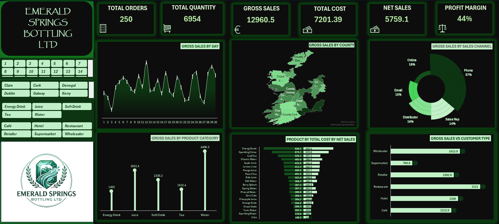

# Sales and Order Analysis

Excel analysis of one month of sales for an Irish beverage distributor. Three disconnected tables, 259 raw order rows that were really 250 orders, and a management team that could see revenue but not what was producing it.

> Portfolio case study. €12,960.50 of gross sales across 250 orders, sitting in data too dirty to answer a basic question about it.



---

## Business Problem

The business produces and distributes bottled water, juices, soft drinks, teas and energy drinks. It sells to restaurants, hotels, retailers, wholesalers, supermarkets and cafés across Ireland.

Management could see revenue was healthy. They could not see what was driving it, because the raw data carried five defects at once:

- Customer, product and order records sat in three separate tables with no working link between them
- The order table held 259 rows for 250 real orders, carrying 5 duplicated records and 4 blank rows
- `Order_Status` appeared in 15 different spellings, including spaces inside words such as `Com  pleted` and `Pen ding`
- Five ID values carried a space inside the ID, across `Order_ID`, `Customer_ID` and `Product_ID`, which breaks any lookup built on them
- Order dates were stored as serial numbers, not readable dates

The defects were not cosmetic. Two of them would have changed the answer, and both are covered below.

---

## Objectives

- Reconcile the order table to one row per real order
- Standardise inconsistent text and convert serial-number dates
- Connect customers, products and orders through ID-based lookups
- Build the calculation layer for sales, cost, discount and profit
- Build a dashboard and turn the figures into decisions

---

## Dataset

| Table | Raw records | After cleaning | Key fields |
|---|---|---|---|
| Customers | 100 | 100 | Customer_ID, Customer_Name, County, Customer_Type, Preferred_Channel |
| Products | 20 | 20 | Product_ID, Product_Name, Category, Bottle_Size, Unit_Price, Cost_Price |
| Orders | 259 | 250 | Order_ID, Order_Date, Customer_ID, Product_ID, Quantity, Discount, Order_Status |

The tables connect through `Customer_ID` and `Product_ID`. Records cover one trading month, June 2026, with orders on all 30 days.

Raw and cleaned copies of all three tables are kept side by side in the workbook, so every transformation can be traced back to source.

---

## Data Cleaning

### 1. Reconciling the order table

259 raw rows reduced to 250 unique orders by removing 5 duplicated records and 4 blank rows. The duplicates were ORD0015, ORD0106, ORD0170, ORD0201 and ORD0243, each appearing twice with identical values.

Row count was checked against distinct `Order_ID` count before anything downstream was built, and the control total stays live in the workbook:

```excel
=COUNTA(Orders[Order_ID])
```

### 2. Repairing the IDs

Five rows carried a space inside an ID value:

| Order | Defect | Field |
|---|---|---|
| ORD0004 | `PROD  016` | Product_ID |
| ORD 0010 | `ORD 0010` | Order_ID |
| ORD0014 | `CUST 026` | Customer_ID |
| ORD 0017 | `ORD 0017` | Order_ID |
| ORD0086 | `PROD  007` | Product_ID |

Three of these sit on lookup keys, and they fail in two different ways.

ORD0004 and ORD0086 carry a broken `Product_ID`, so every product lookup on those rows returns an error. Unit price never arrives, which means €46.70 of gross sales cannot be calculated at all.

ORD0014 carries a broken `Customer_ID`. Its revenue still calculates, because the product lookup works, but €19.00 silently drops out of every county, customer type and channel total. That is the more dangerous failure, because the headline total stays right while the breakdowns quietly do not add up to it.

`TRIM` does not fix either case. `TRIM` removes leading, trailing and repeated spaces, and these are a single space sitting inside a value. `SUBSTITUTE` removes it:

```excel
=SUBSTITUTE(A2," ","")
```

### 3. Standardising the text fields

`Order_Status` arrived in 15 spellings for three real values. The defects were leading spaces, trailing spaces, and spaces inside words: `Com  pleted`, `Com pleted`, `Comp leted`, `Compl eted`, `Pend  ing`, `Pen ding`, `Pen  ing`.

`County` arrived in 29 spellings for 16 counties, mixing `CLARE`, `Clare` and `clare` with padded values like `' Meath'`. `Product_Name` carried line breaks, double spaces and lower case entries such as `apple juice` and `' Berry   Splash '`.

Four functions did the work, each for a different defect:

```excel
=TRIM(A2)                  ' leading, trailing and repeated spaces
=CLEAN(A2)                 ' line breaks and non-printing characters
=PROPER(A2)                ' case inconsistency: CLARE, clare, Clare
=SUBSTITUTE(A2," ","")     ' a space sitting inside a word or an ID
```

Cells changed by this pass:

| Sheet | Column | Cells corrected |
|---|---|---|
| Products | Product_Name | 9 |
| Products | Category | 4 |
| Customers | Customer_Name | 17 |
| Customers | County | 14 |

`Order_Status` went from 15 distinct spellings to 3: 195 Completed, 49 Pending, 6 Cancelled.

Cleaned values were pasted over the source columns, so the finished tables carry values rather than formulas and the pivot cache reads static text.

### 4. The cleaning step that changed a number

`Category` held eight spellings for five categories. One of them was `Wa ter`, a space inside the word, covering PROD012 and PROD020.

Left uncleaned, the dashboard shows six categories instead of five. Water reads €3,355.90 and 25.9% of revenue. A phantom `Wa ter` category sits below it holding €1,140.60.

Cleaned, Water is €4,496.50 and 34.7% of revenue, the largest category in the business by a wide margin.

The uncleaned version does not look broken. It looks like a plausible chart with six bars. That is what makes this class of defect worth finding, and it is why `SUBSTITUTE` belongs in the cleaning set alongside `TRIM`.

### 5. Dates

Order dates arrived as serial numbers and were converted to standard dates, then reduced to a day number for the daily trend and the day slicer:

```excel
=DAY(Orders[[#This Row],[Order_Date]])
```

---

## How the Workbook Is Built

Nine sheets: three raw tables, three cleaned tables, an analysis sheet, a pivot sheet and the dashboard.

The `Orders` table is the spine. It starts as 7 source columns and finishes as 21. The 14 added columns are what turn three disconnected tables into one analysable record.

### The lookup layer

Eight columns are pulled in with `XLOOKUP`, five from Products and three from Customers:

```excel
Unit_Price        =XLOOKUP(Orders[[#This Row],[Product_ID]], Products[Product_ID], Products[Unit_Price])
Cost_Price        =XLOOKUP(Orders[[#This Row],[Product_ID]], Products[Product_ID], Products[Cost_Price])
Product_Name      =XLOOKUP(Orders[[#This Row],[Product_ID]], Products[Product_ID], Products[Product_Name])
Category          =XLOOKUP(Orders[[#This Row],[Product_ID]], Products[Product_ID], Products[Category])
Bottle_Size       =XLOOKUP(Orders[[#This Row],[Product_ID]], Products[Product_ID], Products[Bottle_Size])
County            =XLOOKUP(Orders[[#This Row],[Customer_ID]], Customers[Customer_ID], Customers[County])
Customer_Type     =XLOOKUP(Orders[[#This Row],[Customer_ID]], Customers[Customer_ID], Customers[Customer_Type])
Preferred_Channel =XLOOKUP(Orders[[#This Row],[Customer_ID]], Customers[Customer_ID], Customers[Preferred_Channel])
```

That is 2,000 lookups across the table. `XLOOKUP` is used instead of `VLOOKUP` because it takes the lookup array and the return array as separate arguments, so it does not depend on column position and does not break when a column is inserted into Products or Customers.

Structured references name the table and column instead of a cell range, which is what makes the formula identical in every row and readable a year later.

### The calculation layer

```excel
Gross_Sales    =Orders[[#This Row],[Quantity]]*Orders[[#This Row],[Unit_Price]]
Total_Cost     =Orders[[#This Row],[Cost_Price]]*Orders[[#This Row],[Quantity]]
Total_Discount =Orders[[#This Row],[Unit_Price]]*Orders[[#This Row],[Discount]]*Orders[[#This Row],[Quantity]]
Profit         =Orders[[#This Row],[Gross_Sales]]-Orders[[#This Row],[Total_Cost]]-Orders[[#This Row],[Total_Discount]]
Overal Cost    =Orders[[#This Row],[Total_Cost]]+Orders[[#This Row],[Total_Discount]]
```

`Overal Cost` combines product cost and discount given. It is the field behind the dashboard's `Total Cost` KPI and behind the cost bars on the product chart.

### The analysis sheet

Segment lists are generated rather than typed, so they cannot drift from the data:

```excel
=UNIQUE(Orders[Category])
=UNIQUE(Orders[County])
=UNIQUE(Orders[Customer_Type])
=UNIQUE(Orders[Bottle_Size])
=UNIQUE(Orders[Order_Status])
=UNIQUE(Orders[Product_Name])
```

Each generated list is then measured against the order table with conditional aggregation:

```excel
=SUMIF(Orders[Category], G69, Orders[Gross_Sales])
=SUMIF(Orders[County], G27, Orders[Gross_Sales])
=SUMIF(Orders[Product_Name], A50, Orders[Quantity])
=SUMIF(Orders[Customer_Type], D12, Orders[Gross_Sales])
=COUNTIF(Orders[Category], A42)
=COUNTIF(Orders[Discount], ">0")
=COUNTIF(Orders[Order_Status], "<>Completed")
=COUNTIFS(Orders[Product_Name], D31, Orders[Order_Status], "Cancelled")
```

The two criteria strings are doing real work. `">0"` isolates the 82 discounted orders from the 168 that carry none. `"<>Completed"` counts everything still open or cancelled in one pass, without listing the statuses, so it stays correct if a new status ever appears.

### Classifying categories against the median

The only conditional logic in the workbook bands each category against the median category revenue:

```excel
=IF(H79>MEDIAN($H$79:$H$83),"High",IF(H79<MEDIAN($H$79:$H$83),"Low","Medium"))
```

The median is used instead of the mean on purpose. Five categories with one dominant value would drag an average upward and push three categories below it. The median splits the list where it actually divides.

### The pivot and dashboard layer

Seven pivot tables sit on a single shared cache, sourced from the `Orders` table rather than from a cell range. One cache means one refresh updates everything, and a new order row is picked up automatically.

| Pivot | Rows | Values |
|---|---|---|
| KPI row | none | Count of Order_ID, Sum of Quantity, Gross_Sales, Total_Cost, Profit, Total_Discount, Overal Cost |
| Daily trend | Date Number | Sum of Gross_Sales |
| County | County | Sum of Gross_Sales |
| Channel preference | Preferred_Channel | Sum of Gross_Sales |
| Category | Category | Sum of Gross_Sales |
| Product | Product_Name | Sum of Overal Cost, Sum of Profit |
| Customer type | Customer_Type | Sum of Gross_Sales |

Four slicers sit on `Date Number`, `County`, `Category` and `Customer_Type`, wired to every pivot so one click filters the whole page. `GETPIVOTDATA` links dashboard figures back to the pivot output so the KPI cards update on refresh.

---

## The Dashboard

One page, seven visuals, four slicers. The KPI row answers how the month went. The six charts below it answer where the money came from.

### The KPI row

**250 orders, 6,954 units, €12,960.50 gross sales, €7,201.39 total cost, €5,759.10 net sales, 44% margin.**

Two of those need defining, because the labels do not mean what they usually mean.

`Total Cost` on the dashboard reads the `Overal Cost` field, which combines €6,950.40 of product cost with €250.99 of discount given. `Net Sales` is what remains. €12,960.50 minus €7,201.39 leaves €5,759.11, which is the profit figure every other section of this document uses.

250 orders across 30 days averages 8.3 a day, at an average order value of €51.84.

### Gross Sales by Day

The combined line and area chart moves between €115.50 and €745.80, with order counts between 3 and 13 a day. The peak is 12 June at €745.80. The floor is 3 June at €115.50.

The shape has no weekly rhythm. Peaks land on the 12th, 29th, 25th, 17th and 28th, which fall on different weekdays. Daily revenue here tracks how many orders arrive, not what day of the week it is.

### Gross Sales by County

A filled region map of Ireland. Waterford leads at €1,530.00, then Wexford at €1,474.30, Louth at €1,194.40, Offaly at €1,140.60 and Galway at €1,078.90. The top five of 16 counties account for 49.5% of revenue.

No county is dominant. The largest takes 11.8%. Revenue is spread, which means no single geography is a concentration risk and no single geography is a growth lever on its own.

### Gross Sales by Sales Channel

Phone 37%, Online 18%, Distributor 16%, Email 15%, Sales Rep 14%. In money: €4,773.30, €2,386.00, €2,050.40, €1,961.00 and €1,789.80.

Phone carries exactly twice the revenue of Online, the next group. €4,773.30 divided by €2,386.00 is 2.00.

The underlying field is `Preferred_Channel`, which sits on the customer record. It is each customer's stated preference, not the route each order actually arrived through. The data does not record order routing at all. That distinction decides what this chart can be used for, and it is picked up again in Key Findings.

### Gross Sales by Product Category

Water €4,496.50, Juice €3,052.40, Soft Drink €2,336.20, Tea €1,610.40, Energy Drink €1,465.00.

Water takes 34.7% of revenue. Energy Drink takes 11.3% and sits last. Hold that order, because the next chart reverses it.

### Product by Total Cost by Net Sales

All 20 products, each with a cost bar and a net sales bar, driven by `Sum of Overal Cost` and `Sum of Profit`.

Energy Boost tops the net sales ranking at €628.50, on €836.50 of cost. It is the single most profitable product in the range, and it belongs to the smallest category on the chart above it. Sparkling Citrus follows at €533.90, Vitamin Water at €398.90, Iced Tea at €357.20.

At the bottom, Cola returns €118.80 and Tonic Water €153.50.

The gap between the two charts is the point. Category reporting ranks Energy Drink last. Product reporting puts an energy drink first.

### Gross Sales vs Customer Type

Restaurant €3,121.00, Wholesaler €2,413.90, Hotel €2,348.00, Retailer €2,202.90, Café €2,113.90, Supermarket €760.80.

Five segments sit within 7.8 percentage points of each other. Supermarket sits far below all of them at 5.9%. That gap looks like a weak segment. It is not, and the reason is in Key Findings.

### What the dashboard cannot show

Every visual is built from the `Orders` table. The customer table holds 100 records, and only 90 of those customers placed an order in June. The 10 who placed none appear nowhere on this page, because a pivot built on orders cannot show a customer who did not order.

---

## Key Findings

### Core metrics, June 2026

| Metric | Value |
|---|---|
| Total Orders | 250 |
| Total Quantity | 6,954 units |
| Gross Sales | €12,960.50 |
| Total Cost | €6,950.40 |
| Total Discount | €250.99 |
| Profit | €5,759.11 |
| Profit Margin | 44.4% |

### Revenue rank and profit rank disagree

Energy Drink is the smallest category at 11.3% of revenue, and it holds the most profitable product in the range. Energy Boost returns €628.48 of profit, ahead of all 19 others, and leads on profit per unit at €1.07.

| Category | Revenue | Share | Profit per unit |
|---|---|---|---|
| Water | €4,496.50 | 34.7% | €0.78 |
| Juice | €3,052.40 | 23.6% | €0.87 |
| Soft Drink | €2,336.20 | 18.0% | €0.73 |
| Tea | €1,610.40 | 12.4% | €0.92 |
| Energy Drink | €1,465.00 | 11.3% | €1.07 |

Water leads revenue and sits fourth of five on profit per unit. Energy Drink is last on revenue and first on profit per unit. A business reading the category chart alone would rank its range exactly backwards on margin.

### Revenue by customer type is a picture of the customer list

This is the finding that reframes the dashboard.

| Customer type | Customers | Share of base | Revenue | Share of revenue | Revenue per active customer |
|---|---|---|---|---|---|
| Restaurant | 23 | 23.0% | €3,121.00 | 24.1% | €141.86 |
| Wholesaler | 17 | 17.0% | €2,413.90 | 18.6% | €150.87 |
| Hotel | 17 | 17.0% | €2,348.00 | 18.1% | €138.12 |
| Retailer | 19 | 19.0% | €2,202.90 | 17.0% | €137.68 |
| Café | 16 | 16.0% | €2,113.90 | 16.3% | €150.99 |
| Supermarket | 8 | 8.0% | €760.80 | 5.9% | €152.16 |

Revenue share tracks customer share almost exactly. The correlation between the number of customers in a segment and the revenue it produces is 0.97.

Revenue per active customer runs from €137.68 to €152.16, a spread of €14.48 across six segments. No customer type spends meaningfully more per head than another.

So the question the chart appears to answer, which customer type is the strongest buyer, is not a question this data can answer. The chart ranks segments by how many of each the business has on its books.

### Supermarket is the opposite of what it looks like

Supermarket sits bottom of the chart at 5.9% of revenue, which reads as the weak segment.

It has 8 customers, the smallest segment on the list, and only 5 of them ordered in June. Those 5 produced €760.80, which is €152.16 each, the highest figure of any customer type.

Supermarket is a small segment with the highest dormancy rate in the book, 3 of 8, and the best spend per active customer.

### The phone finding needs the same correction

| Channel preference | Customers | Revenue | Share | Revenue per active customer |
|---|---|---|---|---|
| Phone | 30 | €4,773.30 | 36.8% | €164.60 |
| Online | 19 | €2,386.00 | 18.4% | €132.56 |
| Email | 19 | €1,961.00 | 15.1% | €130.73 |
| Distributor | 18 | €2,050.40 | 15.8% | €128.15 |
| Sales Rep | 14 | €1,789.80 | 13.8% | €149.15 |

Phone carries twice the revenue of Online. It also has 30 customers against 19, so most of that gap is headcount.

Per active customer, phone customers do spend more, €164.60 against €132.56, but that is 24% more, not 100% more. Correlation between customers per group and revenue per group is 0.97, the same pattern as customer type.

Profit margin is flat across all five groups, between 43.8% and 45.1%. No channel preference group is more profitable per euro than another.

### Ten customers bought nothing

90 of 100 customers placed an order in June. The other 10 appear nowhere on the dashboard.

They are 3 retailers, 3 supermarkets, 2 cafés, 1 restaurant and 1 wholesaler. Three of the eight supermarket customers in the business sit in this group.

### Discounting is tight in aggregate and concentrated in practice

Total discount is €250.99, which is 1.9% of gross sales. That number is a blend.

82 of 250 orders carry a discount, at one of two rates: 66 orders at 5% and 16 at 10%. Those 82 orders hold €4,157.00 of gross sales and €250.99 of discount, which is 6.0% of their own value. The remaining 168 orders carry none.

Discounting is not light across the book. It is absent from two thirds of it and running at 5% or 10% on the rest.

### Other figures from the dashboard

- **Peak day:** 12 June at €745.80. Lowest: 3 June at €115.50.
- **Top county:** Waterford €1,530.00, then Wexford €1,474.30. Top five of 16 counties hold 49.5%.
- **Bottle size:** 500ml dominates at €5,362.50, 41.4% of revenue. 1.5L takes €582.00, 4.5%, and carries the highest profit per unit at €0.98. Demand is single-serve, and the format with the best unit margin is the one that barely sells.
- **Order status:** 195 completed, 49 pending, 6 cancelled. 19.6% of orders sit pending, holding €2,326.50.

---

## Recommendations

**Report by product margin, not by category revenue.** Energy Drink is last on revenue and first on profit per unit, and holds the single most profitable product in the range. Category-level reporting is hiding Energy Boost. Add profit per unit to the category view so both rankings sit side by side.

**Reactivate the three dormant supermarket customers before judging the segment.** Supermarket looks weakest at 5.9% of revenue and has the highest revenue per active customer in the business at €152.16. Three of its eight customers ordered nothing in June. That is the cheapest revenue available, because the accounts already exist.

**Work the dormant list as a whole.** 10 of 100 customers bought nothing in June. Establish whether they are lapsed, seasonal or administrative before any spend goes into new customer acquisition.

**Stop reading the customer type chart as buying behaviour.** Revenue per active customer varies by €14.48 across six segments and revenue share tracks customer count at 0.97 correlation. Growth in any segment comes from adding or reactivating customers in it, not from a segment buying harder.

**Protect phone ordering, for the right reason.** 30 of 100 customers state phone as their preference and they produce 36.8% of revenue. The driver is mostly group size, so the risk of removing phone ordering is that it strands the largest customer group, not that it destroys a uniquely high-value channel.

**Record the channel each order actually arrives through.** The business stores a stated preference on the customer record and nothing on the order. Until order routing is captured, no channel decision can be measured after it is made.

**Investigate the 49 pending orders.** €2,326.50 of gross sales sits in this status, 19.6% of orders. The pending rate runs between 15.1% and 23.1% across channel preference groups and between 16.7% and 22.7% across the five weeks of June, so no channel and no period explains it. That points to a process or reporting issue. Confirm whether these orders convert or lapse before treating them as revenue.

**Review the 1.5L format.** It carries the best profit per unit at €0.98 and produces 4.5% of revenue. Either it is priced for demand that does not exist, or it is under-promoted.

---

## Limitations

- **One month of data.** June 2026 only. These are one month's patterns, not a trend. Repeating the review monthly would establish whether they hold.
- **Revenue includes 6 cancelled orders worth €315.40,** 2.4% of gross sales. Excluding them reduces gross sales to €12,645.10. The order book is reported as recorded, not as settled.
- **`Preferred_Channel` is a customer attribute, not an order attribute.** The data does not record which channel each order came through, so every channel figure describes the customer base and not transaction routing.
- **The `Total Cost` KPI on the dashboard reads `Overal Cost`, which includes discount.** The Key Findings table separates the two. Both reconcile to the same €5,759.11 profit.
- **`PROPER` lower-cases the second capital in names like McCarthy.** This affects `Customer_Name` only, which is not used in any calculation or visual, so no figure is touched.
- **Revenue per active customer is calculated across one month.** A customer who ordered twice in June and one who ordered once both count as one active customer.
- **This is a training case study using a prepared dataset, not live commercial data.**

---

## Skills Demonstrated

**Data assessment and reconciliation**
Row count validation against distinct keys, duplicate identification, blank row removal, control totals held live in the workbook with `COUNTA`

**Text cleaning**
`TRIM` for padding and repeated spaces, `CLEAN` for line breaks and non-printing characters, `PROPER` for case inconsistency, `SUBSTITUTE` for spaces sitting inside words and IDs, across 44 corrected cells and 15 status spellings

**Date handling**
Serial number to date conversion, `DAY` for the day dimension

**Relational modelling in Excel**
`XLOOKUP` across three tables and eight columns, 2,000 lookups, using Excel Tables and structured references so formulas survive column changes

**Calculation layer**
Line-level gross sales, cost, discount, profit and combined cost columns, each reconciling to a control total

**Conditional aggregation**
`SUMIF`, `SUMIFS`, `COUNTIF` and `COUNTIFS`, including the criteria operators `">0"` and `"<>Completed"` for threshold and exclusion counts

**Dynamic arrays**
`UNIQUE` to generate segment lists directly from the order table, so lists cannot drift from the data

**Statistical banding**
`IF` nested with `MEDIAN` to classify categories High, Medium and Low against the median rather than the mean

**PivotTables and dashboard build**
Seven pivot tables on one shared cache sourced from a Table, four slicers cross-filtering every visual, `GETPIVOTDATA` linking KPI cards to pivot output, combined line and area chart, doughnut, bar charts and a filled region map

---

## Files

| File | Description |
|---|---|
| `emerald-project.xlsx` | Full workbook: raw tables, cleaned tables, analysis, pivots and dashboard |
| `emerald-raw-data.xlsx` | Original raw data before cleaning |
| `emerald-dashboard.png` | Dashboard screenshot |
| `emerald-presentation.pptx` | Presentation deck |
| `emerald-presentation.pdf` | Presentation, viewable in browser |
